# 就活小助手 · Shukatsu Buddy

> 面向在日本求职、工作的中国人的 AI 助手 —— **中文操作，日文产出**。
> An AI job-hunting assistant for Chinese students and professionals in Japan: think in Chinese, apply in Japanese.

ES 添削、选考追踪、日文邮件识别、笔试类型管理、前辈经验分享，一个 `docker compose up` 就能部署到你自己的服务器。
不限届数：在读学生、各届求职者、已经在日本工作的前辈都能使用。

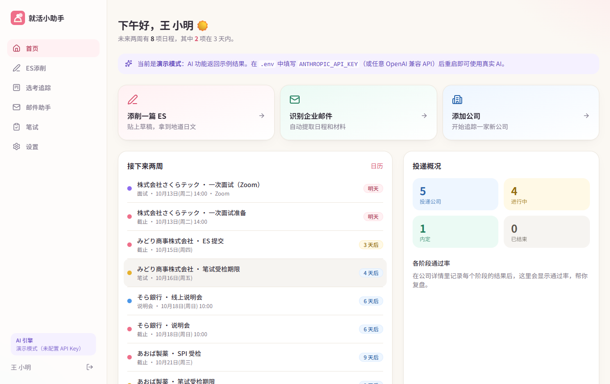

---

## 目录

- [功能一览](#功能一览)
- [快速开始（Docker，推荐）](#快速开始docker推荐)
- [部署到你的网站](#部署到你的网站)
- [接入大模型](#接入大模型)
- [使用指南](#使用指南)
- [设计理念](#设计理念)
- [技术架构](#技术架构)
- [本地开发](#本地开发)
- [配置项](#配置项)
- [与 PRD 的对应关系 & 路线图](#与-prd-的对应关系--路线图)

---

## 功能一览

| 模块 | 你能做什么 | AI 参与 |
| --- | --- | --- |
| ✍️ **ES 添削** | 输入公司、题目、字数上限和草稿（中文/日文都行），得到日文改写稿、逐句中文说明、三项结构评分 | Claude 按结构化 JSON 输出；超字数时自动再压缩一次 |
| 📚 **素材库** | 把写好的ガクチカ、自己PR 存起来，写别家公司时一键导入再按公司调整 | — |
| 🗂️ **选考追踪** | 看板（拖拽改阶段）+ 月历视图；每家公司的阶段可增删、记录日期与结果（通过/未通过/待定） | — |
| 💌 **邮件识别** | 粘贴企业日文来信 → 提取日期、地点/链接、所需材料、回复期限、笔试类型 → 确认后写入公司卡片 | 结构化抽取 + 置信度 + 不确定点提示 |
| ↩️ **回信辅助** | 接受面试、调整日程、辞退选考/内定、感谢信等场景，生成符合商务敬语的日文回信 | 不确定信息用【　】留空，绝不编造 |
| 📝 **笔试准备** | 按笔试类型（SPI / 玉手箱 / TG-WEB / GAB / CAB / クレペリン…）汇总公司，提示优先准备哪一种，附备考要点和留学生易失分点 | 邮件中自动识别类型 |
| 📅 **提醒** | 每个用户一条私有日历订阅链接（.ics），手机日历自动提醒：截止前 3 天 & 1 天、面试前一晚 | — |
| 🌱 **经验分享** | 用户之间分享**面试经验**和入职后的**工作体验**；每篇强制标注时间（面试年月 + 届数 / 在职起止），按公司、年份、标签检索，「有帮助」投票，旧经验自动提示时效 | 粗略描述 → AI 整理成分节文章 + 补充建议 + 隐私提醒 → 用户修改 → 预览确认后才发布 |
| 🔔 **通知** | 管理员发给全站或指定用户的公告；未读数显示在侧边栏，「重要」通知置顶在首页直到点「知道了」 | — |
| 💬 **意见反馈** | 用户随时向管理员提建议或报问题（自动附带所在页面），查看处理状态和管理员回复，有新回复时侧边栏红点提醒；每人每天最多 10 条 | — |
| 📊 **复盘统计** | 投递数、进行中、内定、各阶段通过率 | — |
| 🛡️ **管理后台** | 管理员选择 AI 服务与模型、填写 API Key；按用户 ID 开通 AI；设置每日次数；处理举报（隐藏 / 删除 / 驳回）；停用账号；**批量导入经验分享**（CSV / Excel / JSON）；查看用户与 AI 用量统计 | 连接测试、在线查看可用模型；把原始访谈材料拆分整理成多篇分享 |
| 🔒 **隐私** | 数据按用户隔离；设置页一键删除全部数据 / 注销账号；可修改密码 | — |

<table>
<tr>
<td>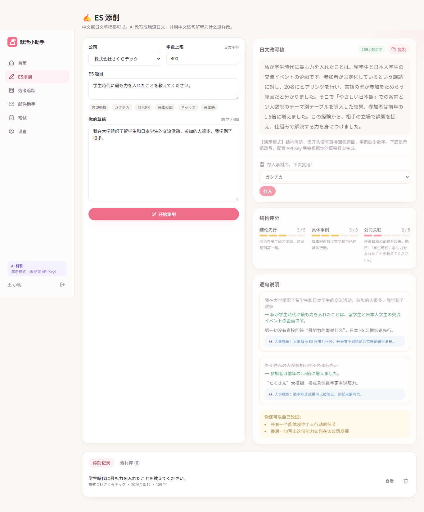</td>
<td>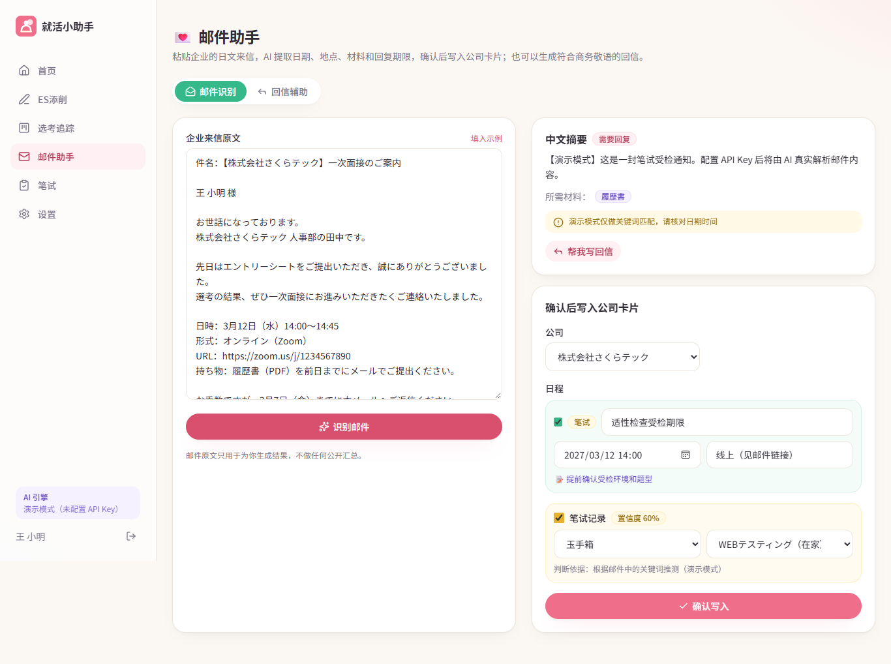</td>
</tr>
<tr>
<td>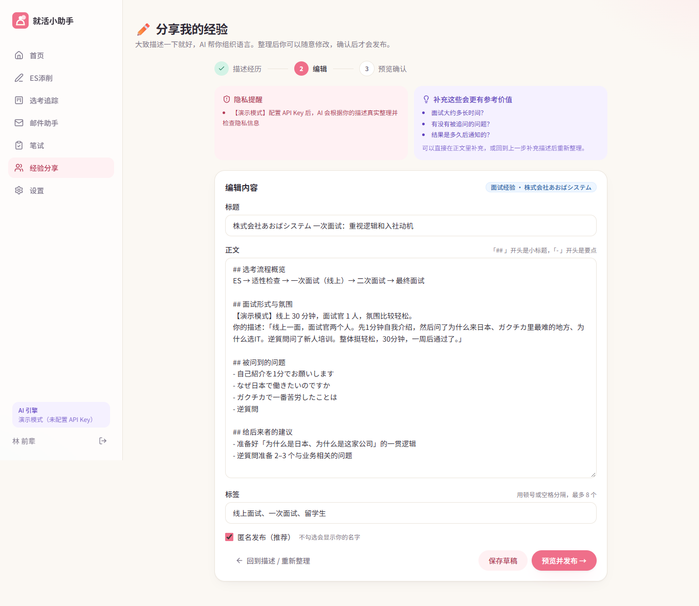</td>
<td>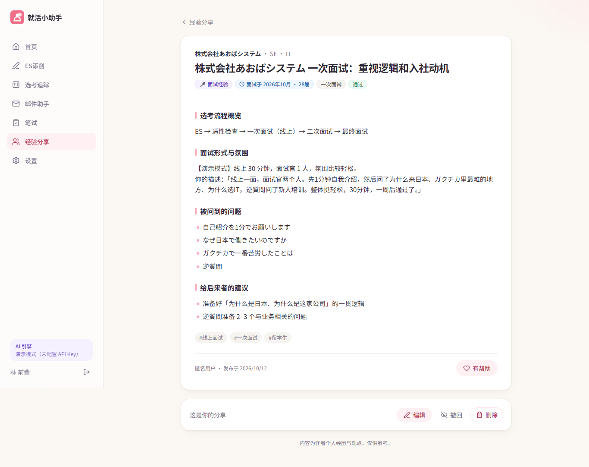</td>
</tr>
<tr>
<td>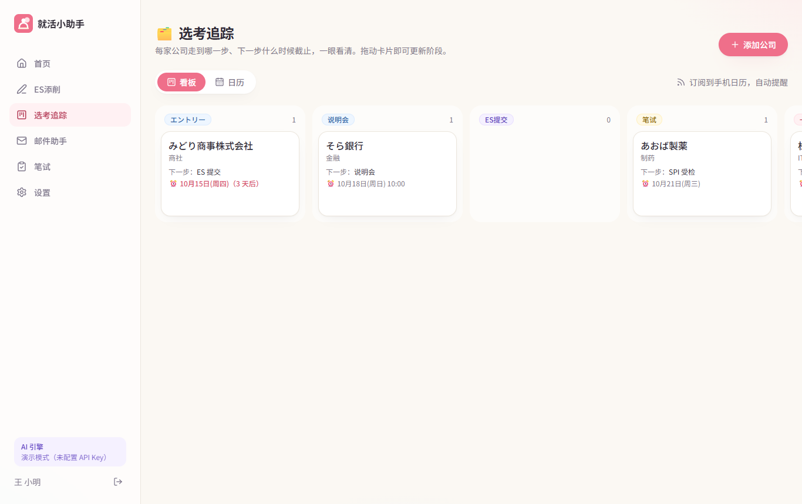</td>
<td>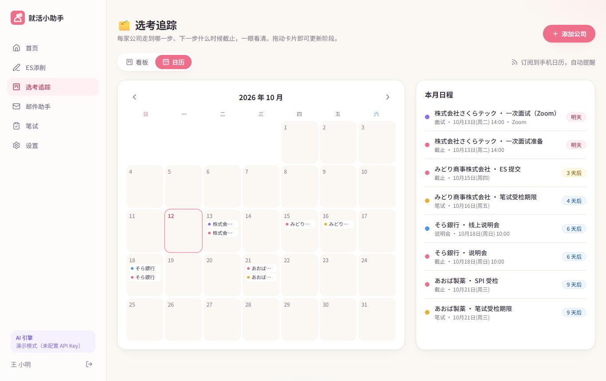</td>
</tr>
</table>

---

## 快速开始（Docker，推荐）

只需要安装 [Docker](https://docs.docker.com/get-docker/)（含 Docker Compose v2）。

```bash
git clone https://github.com/MOLESHEEP/shukatsu-buddy.git
cd shukatsu-buddy

cp .env.example .env
# 编辑 .env：至少修改 AUTH_SECRET 和 POSTGRES_PASSWORD
#   AUTH_SECRET 可以用：openssl rand -base64 32
# 想用真实 AI：填任意一家的 Key（Claude / ChatGPT / DeepSeek / Kimi / 千问 / GLM / Gemini / 豆包…）

docker compose up -d --build
```

打开 <http://localhost:3000>，注册账号即可使用。

> **没有 API Key 也能跑**：未配置任何 Key 时自动进入「演示模式」，AI 功能返回示例结果，方便先体验完整流程。

常用命令：

```bash
docker compose logs -f app        # 查看日志
docker compose pull && docker compose up -d   # 更新（使用预构建镜像时）
docker compose down               # 停止（数据保留在 pgdata 卷中）
docker compose down -v            # 停止并删除所有数据（慎用）
```

数据库表结构会在首次访问时自动创建，无需手动迁移。

---

## 部署到你的网站

### 推荐：Cloudflare Tunnel + 一键脚本（最省钱）

适合域名托管在 Cloudflare 的情况。服务器不需要公网端口和证书，Cloudflare 免费提供 HTTPS、CDN 和 DDoS 防护，还能隐藏服务器 IP。服务器直接拉取 GitHub 自动构建好的镜像（支持 x86 和 ARM），**1 GB 内存的最便宜 VPS 就够用**。

1. **创建隧道**：Cloudflare 面板 → Zero Trust → Networks → Tunnels → Create a tunnel（类型选 Cloudflared），起个名字，复制安装命令里 `--token` 后面那一长串（这就是 `TUNNEL_TOKEN`）。
2. **添加公网域名**：在这个隧道的 Public Hostname 里添加一条：子域名如 `shukatsu`、选择你的域名，Service 填 `HTTP` + `app:3000`。Cloudflare 会自动创建 DNS 记录。
3. **在服务器上运行一键脚本**（Ubuntu / Debian）：
   ```bash
   curl -fsSL https://raw.githubusercontent.com/MOLESHEEP/shukatsu-buddy/main/deploy/install.sh | sudo bash
   ```
   脚本会安装 Docker、在小内存机器上加 2 GB swap、生成随机密钥，并询问域名、管理员邮箱 / 密码和 `TUNNEL_TOKEN`，然后启动全部服务。
4. 打开 `https://你的子域名`，用管理员账号登录，在「管理后台 → AI 与额度」填 API Key 即可。

更新到最新版：`cd /opt/shukatsu-buddy && git pull && docker compose --profile tunnel pull && docker compose --profile tunnel up -d --no-build`

### 方式一：服务器上直接构建

在任意 Linux VPS（1 vCPU / 1 GB 内存即可）上执行上面的「快速开始」，然后：

**自带 HTTPS（推荐）** —— 项目内置了 [Caddy](https://caddyserver.com/) 反向代理，会自动申请 Let's Encrypt 证书：

```bash
# 1. 把域名的 A 记录指向服务器 IP
# 2. 在 .env 中设置：
#      DOMAIN=shukatsu.your-site.com
#      PUBLIC_URL=https://shukatsu.your-site.com
# 3. 启动（带 https profile）
docker compose --profile https up -d --build
```

服务器需要开放 80 / 443 端口。

**已有 Nginx / 宝塔 / 1Panel 等反向代理？** 不启用 https profile，直接把你的代理指向 `http://127.0.0.1:3000`（可用 `APP_PORT` 修改端口），并转发 `X-Forwarded-Proto` 头。

### 方式二：使用预构建镜像（不在服务器上编译）

推送到 `main` 分支后，GitHub Actions（`.github/workflows/docker.yml`）会自动构建 `linux/amd64` + `linux/arm64` 镜像并发布到 GitHub Container Registry：

```bash
# .env 中添加：
APP_IMAGE=ghcr.io/molesheep/shukatsu-buddy:latest

docker compose pull
docker compose up -d --no-build
```

> 镜像默认是私有包。如需匿名拉取，请在 GitHub → Packages → shukatsu-buddy → Package settings 中改为 Public，或在服务器上 `docker login ghcr.io`。

### 方式三：其他容器平台

`Dockerfile` 产出的是标准的单容器 Node 服务（端口 3000，健康检查 `/api/health`），可直接部署到 Railway、Render、Fly.io、Google Cloud Run、Azure Container Apps、Kubernetes 等。只需要：

- 一个 PostgreSQL 数据库，把连接串填入 `DATABASE_URL`
- 设置 `AUTH_SECRET`、`PUBLIC_URL` 以及 LLM 相关环境变量

### 备份

```bash
docker compose exec db pg_dump -U shukatsu shukatsu > backup.sql          # 备份
docker compose exec -T db psql -U shukatsu shukatsu < backup.sql          # 恢复
```

---

## 接入大模型

支持主流的国内外大模型，**在 `.env` 里填任意一家的 API Key 即可**，不需要改代码。

| ID（`LLM_PROVIDER`） | 服务 | API Key 变量（任填其一） | 默认模型 | JSON 输出方式 |
| --- | --- | --- | --- | --- |
| `anthropic` | **Claude**（Anthropic） | `ANTHROPIC_API_KEY` | `claude-opus-5-5` | 官方 SDK 结构化输出 |
| `openai` | **ChatGPT**（OpenAI） | `OPENAI_API_KEY` | `gpt-6.1-sol` | `json_schema` |
| `deepseek` | **DeepSeek** 深度求索 | `DEEPSEEK_API_KEY` | `deepseek-flash` | `json_object` |
| `kimi` | **Kimi**（Moonshot 月之暗面） | `KIMI_API_KEY` / `MOONSHOT_API_KEY` | `kimi-k3` | `json_object` |
| `qwen` | **通义千问 Qwen**（阿里云百炼） | `QWEN_API_KEY` / `DASHSCOPE_API_KEY` | `qwen-plus` | `json_object` |
| `glm` | **智谱 GLM** | `GLM_API_KEY` / `ZHIPU_API_KEY` | `glm-5.3` | `json_object` |
| `gemini` | **Gemini**（Google） | `GEMINI_API_KEY` / `GOOGLE_API_KEY` | `gemini-3.8-flash` | `json_schema` |
| `doubao` | **豆包 Doubao**（火山方舟） | `DOUBAO_API_KEY` / `ARK_API_KEY` | 需设置 `DOUBAO_MODEL` | `json_object` |
| `ollama` | **Ollama** 本地模型 | 无需 | 需设置 `OLLAMA_MODEL` | `json_object` |
| `custom` | 任意 OpenAI 兼容服务（OpenRouter、SiliconFlow、vLLM、LM Studio…） | `CUSTOM_API_KEY`（可选） | 需设置 `CUSTOM_MODEL` | 可配置 |

- 每家都能用 `<ID>_MODEL` 换模型、`<ID>_BASE_URL` 换地址（如 Kimi 国内账号用 `KIMI_BASE_URL=https://api.moonshot.cn/v1`，千问海外地域用控制台给出的地址）、`<ID>_JSON_MODE` 覆盖 JSON 方式。
- `LLM_PROVIDER=auto`（默认）会按上表顺序选第一个配置好的；也可以直接指定，例如 `LLM_PROVIDER=deepseek`。
- **备用链**：`LLM_FALLBACK=kimi,qwen` —— 主力超时、5xx 或限流时自动换下一家，用户无感知。
- **也可以完全在网页上配置**：管理员在「管理后台 → AI 与额度」里填 API Key、选主力 / 备用、换模型，**立即生效、无需重启**。后台设置优先于 `.env`；Key 用 `AUTH_SECRET` 派生的密钥以 AES-256-GCM 加密存入数据库，页面上只显示掩码（因此更换 `AUTH_SECRET` 后需要重新填写 Key）。
- **模型名会过时**：各家改名很频繁（默认值核对于 2026 年 10 月）。在管理后台点「测试」验证 Key / 模型 / JSON 输出，点「查看可用模型」列出这个 Key 当前能用的全部模型，点一下即可选用。

示例：

```bash
# 只用 Claude
ANTHROPIC_API_KEY=sk-ant-...

# DeepSeek 为主，Kimi 和千问做备用
LLM_PROVIDER=deepseek
LLM_FALLBACK=kimi,qwen
DEEPSEEK_API_KEY=sk-...
KIMI_API_KEY=sk-...
QWEN_API_KEY=sk-...

# 本地 Ollama（模型跑在宿主机上）
OLLAMA_MODEL=qwen3:14b

# OpenRouter 等聚合服务
CUSTOM_BASE_URL=https://openrouter.ai/api/v1
CUSTOM_API_KEY=sk-or-...
CUSTOM_MODEL=anthropic/claude-sonnet-5.5
```

**OpenAI 兼容服务的调用细节**（`src/lib/llm/provider.ts`）

- 能用 `json_schema` 的服务直接传 schema；只支持 `json_object` 的服务在提示词里附上 JSON Schema；返回结果一律经 Zod 校验，不合格自动带着错误原因重试一次。
- 自动去掉推理模型的 `<think>…</think>`、Markdown 代码块和多余文字。
- 401 / 404（模型不存在）/ 402（余额不足）/ 429 / 5xx / 超时都给出具体的中文提示。

**Claude 调用细节**

- 使用 `client.beta.messages.parse()` + Zod schema（`src/lib/llm/schemas.ts`），模型输出被约束为合法 JSON，直接写入数据库和渲染页面。
- 按任务设置推理强度（`effort`）：ES 添削用 `medium`，邮件解析和回信用 `low`，兼顾质量与速度/成本。
- 默认开启服务端 **refusal fallback**（`fallbacks: "default"`）：极少数情况下安全分类器误拒时，API 会自动换模型重试。如通过代理或不支持该参数的平台访问，可设置 `ANTHROPIC_FALLBACKS=off` 关闭。
- 对 `refusal` / `max_tokens` 停止原因和限流、鉴权错误都有中文提示。

**提示词**集中在 `src/lib/llm/tasks.ts`，与代码分开维护，方便持续打磨。

---

## 使用指南

1. **注册** → 在「设置」里填写毕业年份、专业、日语水平（AI 改 ES 时会参考）。
2. **添加公司**：首页或「选考」页点「添加公司」。会自动建立标准流程：エントリー → 说明会 → ES提交 → 笔试 → 一次面试 → 二次面试 → 最终面试 → 内定。在公司详情页可以增删、排序阶段，记录每一步的日期和结果。
3. **写 ES**：在公司详情页点「为这家公司写 ES」，公司备注会作为背景提供给 AI。选择题目模板（志望動機 / ガクチカ / 日本就職…）或自己输入，粘贴草稿后点「开始添削」。满意的回答点「存入素材库」。
4. **收到企业邮件**：复制全文到「邮件助手 → 邮件识别」，核对 AI 提取的日程和笔试类型，选择对应公司后「确认写入」。需要回复时点「帮我写回信」。
5. **订阅提醒**：「设置 → 日历订阅」复制链接，在 iPhone「设置 → 日历 → 账户 → 添加已订阅的日历」或 Google 日历「通过网址添加」，之后所有日程会自动同步并提醒。
6. **准备笔试**：「笔试」页按类型汇总你的公司，告诉你优先准备哪一种。
7. **分享经验**：「经验」→「分享我的经验」，三步完成：
   1. **描述经历**：选择「面试经验」或「工作体验」，填写公司、职种和**时间**（面试年月 + 当时届数；或入职 / 离职年月，可选「至今在职」），然后随便写写经历，不用在意语句。
   2. **编辑**：点「AI 帮我整理」，AI 只用你提供的事实组织成分节文章（流程、问题、建议…），并提示「补充哪些会更有参考价值」和「隐私风险」。标题、正文、标签都可以随意修改，也可以先「保存草稿」。
   3. **预览确认**：看到的就是别人看到的样子；勾选「我已检查…」后才能发布。发布后仍可编辑（需再次预览确认）、撤回或删除。

   读者可以按公司 / 行业 / 标签搜索、按年份筛选、按「最新经历」或「最有帮助」排序；超过 2 年的经验会提示时效。公司详情页会自动显示这家公司的前辈经验。在「设置」里把身份改为「已经在日本工作」，新建分享时会默认选择「工作体验」。
8. **手机上使用**：用浏览器打开网站后「添加到主屏幕」，即可像 App 一样使用（PWA）。

### 管理员

1. **创建管理员**：在服务器的 `.env` 中设置 `ADMIN_EMAILS` 和 `ADMIN_PASSWORD`，启动后自动创建管理员账号（已存在的同名账号会被设为管理员）。登录后请到「设置 → 修改密码」改掉初始密码。
2. 管理员侧边栏会多出「管理后台」，包含四页：
   - **概览**：用户数、7 天活跃、待处理举报、近 14 天 AI 调用趋势、按服务 / 模型 / 功能的用量和成功率。
   - **用户**：按 ID / 邮箱 / 名字搜索；每个用户一个 **AI 开关**（开通 / 关闭 / 跟随默认）；展开后可单独设置每日额度、**重置今日次数**、停用 / 恢复账号。
   - **反馈**：用户提交的建议和问题，按状态（待处理 / 处理中 / 已采纳 / 已完成 / 已关闭）和类别筛选；直接回复用户（回复后自动转为「处理中」，用户侧边栏出现红点），可跳转到用户和问题页面。侧边栏「管理后台」会显示待处理的反馈 + 举报数量。
   - **通知**：给**所有用户**或**指定用户 ID** 发送公告（标题、内容、可选链接），可设为「重要」置顶在用户首页；带实时预览，能看到每条的已读人数，可撤回或删除。新注册的用户能看到旧公告，但不会被算作未读。
   - **注册与邀请**：控制谁能注册，改完立即生效——
     - 模式：**开放注册 / 仅限邀请码 / 关闭注册**，可自定义暂停或满额时的提示语；
     - 上限：**用户总数上限**、**每 24 小时注册上限**（默认 50）、**同一 IP 每 24 小时注册上限**（默认 3；IP 只保存加密哈希）；注册在数据库锁内校验，并发注册也不会超额；表单内置防机器人隐藏字段；
     - **邀请码**：批量生成，设置可用次数、有效天数和备注，一键复制带邀请码的注册链接（`/register?invite=XXXX-XXXX`，打开即自动填好），可停用 / 删除，能看到每个邀请码注册了哪些账号。
     - 管理员邮箱不受这些限制。按 IP 限制依赖 Cloudflare / 反向代理传来的真实 IP；请像推荐部署那样用 `APP_BIND=127.0.0.1` 不直接暴露 3000 端口，否则 IP 请求头可能被伪造（总数和每日上限仍然有效）。
   - **举报**：查看用户举报的经验分享，一键「驳回 / 隐藏帖子 / 删除帖子」。被隐藏的帖子只有作者和管理员能看到，作者不能自行重新发布。
   - **批量导入**：一次添加多篇经验分享，两种方式：
     - **表格导入**：下载 CSV 模板，用 Excel 填好后上传，或直接从 Excel / Google 表格复制粘贴（也支持 JSON）。表头可用中文（类型、公司、行业、职种、时间、结束、届、阶段、结果、雇佣形式、评分、标题、正文、标签、匿名、来源），时间写 `2027-03`、`2027/3`、`2027年3月` 都可以，「结束」写「至今」表示仍在职，正文里 `\n` 表示换行、`## ` 开头为小标题。
     - **AI 整理原始材料**：粘贴访谈记录、问卷回答、群聊整理等（一次最多 6 万字），AI 把每段经历拆成一篇、分小节整理；只用材料里的事实，没写明的时间会留空让你补。
     - 导入前逐条**预览和校验**（缺公司 / 时间 / 标题、正文太短、结束早于开始等会标红），可以就地修改或取消勾选；服务器端还会再校验一次。
     - 可选「导入为草稿」（之后逐篇修改，或在导入记录里一键全部发布）或「直接发布」（需勾选确认内容已获授权、无隐私问题）。
     - 导入的帖子归属管理员账号、默认匿名，可填写「来源」显示在帖子上。每次导入是一个**批次**，可以整批发布或整批撤销。
   - **AI 与额度**：选择主力和备用 AI、填写各家 API Key、换模型 / 接口地址、测试连接、查看可用模型；设置「新用户默认能否用 AI」和每人每天的默认次数。
3. **给用户开通 AI**：用户在「设置」里能看到自己的**用户 ID**（没开通时，ES / 邮件页面也会提示），把 ID 发给管理员 → 管理员在「用户」页搜索该 ID，点「开通」。
4. 管理员本人不受 AI 开关和每日次数限制。

<table>
<tr>
<td>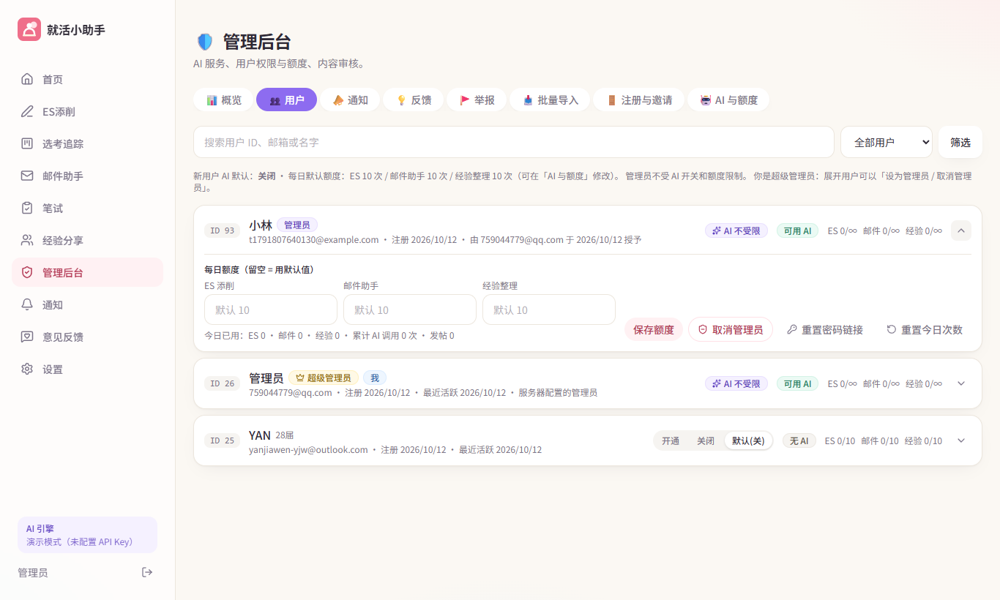</td>
<td>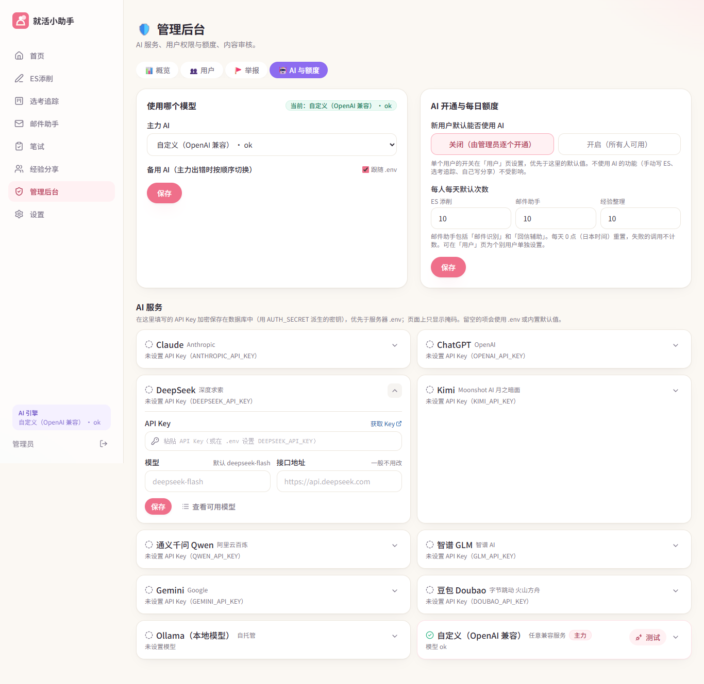</td>
</tr>
<tr>
<td colspan="2">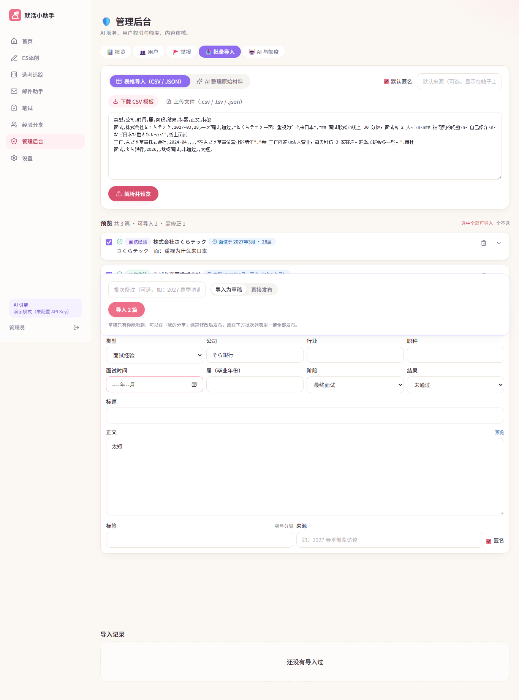</td>
</tr>
<tr>
<td>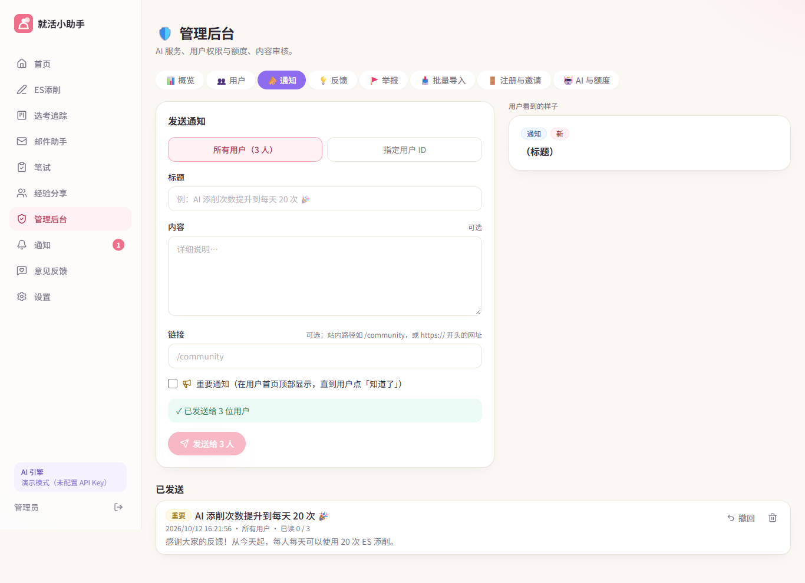</td>
<td>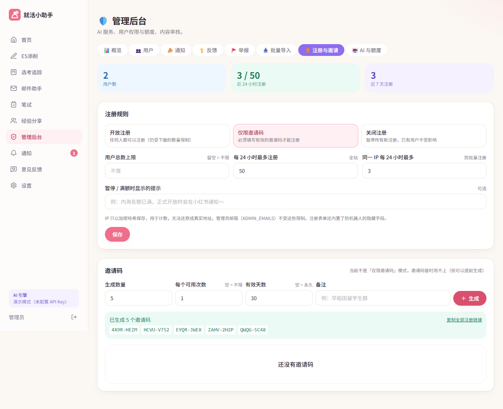</td>
</tr>
</table>

---

## 设计理念

### 产品原则

- **辅导，而不是代写**。ES 改写保留学生自己的经历和观点，绝不编造数字或成果；每处修改都附中文说明和「日本人事会怎么理解」，目的是让用户真正学会。这也降低了诚信风险。
- **中文思考，日文表达**。所有界面、解释、摘要都用中文；所有要交给企业的东西（ES、回信）都是地道的日文。
- **AI 只做建议，人来确认**。邮件识别的结果先展示、可编辑，用户确认后才写入；置信度低或不确定的地方会明确标出。经验分享同理：AI 整理的只是草稿，必须经过「编辑 → 预览 → 勾选确认」才能发布，服务端也会拒绝未确认的发布请求。
- **经验必须有时间**。就活流程每年都在变，所以每篇分享都强制记录发生时间（面试年月 + 届数，或在职起止），列表默认按「经历新旧」而不是发帖时间排序，超过 2 年自动提示时效。
- **AI 整理，但不替你说话**。经验分享的提示词要求只使用用户提供的事实、保留第一人称和个人观点、不编造不美化，并主动模糊面试官 / 同事姓名等可识别信息。默认匿名发布；用户的原始粗略描述只保存给作者本人，永不公开。
- **AI 是可控的成本**。AI 默认由管理员按用户开通，每人每天有次数上限（默认 ES 10 次、邮件助手 10 次、经验整理 10 次，后台可改、可对个人单独设置），失败的调用不计数，每次调用都记录服务、模型、耗时，方便估算费用。不用 AI 的功能（手写 ES 保存、选考追踪、自己写分享）对所有人开放。
- **隐私优先**。数据只属于用户本人，不做公开汇总，一键删除。

### 视觉设计：温和 · 轻盈 · 鲜活

就活本身压力很大，所以界面刻意做得**安静、柔和、有一点点可爱**：

| 设计决策 | 做法 |
| --- | --- |
| **温和**的底色 | 暖米白画布 `#FBF8F3` + 纯白卡片，避免冷冰冰的灰白；极淡的径向渐变色块作为背景氛围 |
| **轻盈**的结构 | 大圆角（20px）、柔和的双层阴影、细描边；信息分块但不堆叠边框；充足留白 |
| **鲜活**的点缀 | 五个「粉彩但饱和」的强调色，各有语义：🌸 樱粉 = 主操作 / ES；🌿 薄荷 = 邮件 / 完成；☁️ 天蓝 = 说明会 / 进行中；🍋 柠檬 = 笔试 / 提醒；🪻 紫罗兰 = 面试 / AI |
| 颜色的用法 | 强调色主要以 50/100 的淡底 + 700 的深字出现（徽章、提示框），只有主按钮使用实色，保证鲜活但不刺眼 |
| 紧迫感分级 | 截止日按「今天/明天 → 3 天内 → 更远」用樱粉 → 柠檬 → 天蓝区分，一眼看出轻重缓急 |
| 微动效 | 卡片淡入上浮、悬停轻微抬起、按钮按下回弹；不做多余动画 |
| 中日文排版 | 字体栈同时覆盖简体中文与日文（PingFang / Hiragino / Noto Sans CJK / Yu Gothic），日文段落使用 `lang="ja"` 和更大行高 |
| 移动优先 | 手机上底部 Tab 栏 + 弹出式表单（bottom sheet），桌面上侧边栏；看板在触屏上用下拉菜单代替拖拽 |

所有设计 token 定义在 `src/app/globals.css` 的 `@theme` 中，改主题只需改这一处。

### 易用性

- 首页三个大入口覆盖 90% 的操作：添削 ES、识别邮件、添加公司。
- 所有表单都有示例占位符；邮件助手有「填入示例」一键体验。
- 未配置 API Key 也能完整体验（演示模式），降低部署门槛。

---

## 技术架构

```
浏览器 (PWA, React 19)
   │
   ▼
Next.js 16 App Router ──────────────────────────────┐
   │  Server Components：直接查询数据库渲染页面        │
   │  Route Handlers  ：/api/* JSON 接口               │
   │  proxy.ts        ：未登录访问重定向                 │
   │                                                    │
   ├── src/lib/db.ts      pg 连接池 + 自动建表 (db/schema.sql)
   ├── src/lib/auth.ts    bcrypt 密码 + JWT(HS256) httpOnly Cookie
   ├── src/lib/data.ts    数据访问（全部按 user_id 隔离）
   └── src/lib/llm/       providers.ts 10 种 AI 服务的注册表（地址 / 默认模型 / Key 变量 / JSON 方式）
                          provider.ts  调用层：Claude SDK、OpenAI 兼容协议、备用链、演示模式、连接测试
                          schemas.ts   Zod 结构化输出定义
                          tasks.ts     提示词：ES 添削 / 邮件解析 / 回信 / 经验整理
   ├── src/lib/posts.ts   经验分享查询（公开内容不含作者原始描述）
   │
   ▼
PostgreSQL 17
```

**容器化**

- `Dockerfile`：三阶段构建（deps → build → run），Next.js `standalone` 输出，非 root 用户运行，内置健康检查，镜像约 150 MB。
- `docker-compose.yml`：`db`（Postgres + 健康检查 + 持久卷）、`app`、可选 `caddy`（`--profile https`，自动 HTTPS）。
- `.github/workflows/docker.yml`：多架构镜像自动发布到 GHCR。

**数据模型**（PRD 中的七张表）

| 表 | 用途 |
| --- | --- |
| `users` | 账号、背景信息、套餐、AI 用量、日历订阅 token |
| `companies` | 公司卡片：行业、渠道、当前阶段、状态、下一步与截止、备注 |
| `stages` | 每家公司的选考流程，可增删排序，记录日期和结果 |
| `tests` | 笔试记录：类型（固定枚举）、形式、受检期限、状态、AI 识别置信度 |
| `events` | 日历与提醒的数据来源，可关联来源邮件 |
| `emails` | 粘贴的邮件原文与 AI 解析结果、是否已确认 |
| `es_docs` | ES 草稿、改写稿、完整点评（JSONB）、素材库标记 |
| `posts` | 经验分享：类型、公司 / 职种、**时间标签**（`occurred_on` / `ended_on` / `grad_year`）、阶段与结果或雇佣形式与评分、正文、标签、匿名、草稿 / 已发布、作者私有的原始描述 |
| `post_votes` | 「有帮助」投票（每人每篇一票） |
| `post_reports` | 举报及处理状态 |
| `feedback` | 用户意见反馈、所在页面、处理状态、管理员回复及是否已读 |
| `announcements` / `announcement_reads` | 管理员通知（全站或指定用户）及每个用户的已读记录 |
| `invite_codes` | 邀请码、可用次数、有效期；`users.invite_code`、`users.signup_ip_hash` 记录注册来源 |
| `import_batches` | 管理员批量导入的批次（用于整批发布 / 撤销）；`posts.import_batch`、`posts.source` 记录归属和来源 |
| `app_settings` / `ai_usage` | 后台可改的 AI 配置与额度；每次 AI 调用的服务、模型、耗时、成败 |

`users.career_stage`（学生 / 已工作）区分身份；表结构变更都写在 `db/schema.sql` 中且幂等，旧部署升级时会自动补齐新表和新列。

```
src/
├── app/
│   ├── (auth)/            登录 / 注册
│   ├── (app)/             登录后的页面：dashboard, es, tracker, inbox, tests, settings
│   ├── api/               JSON 接口
│   ├── layout.tsx, page.tsx (落地页), globals.css (设计 token)
├── components/            UI 组件（Button, Card, Badge…）、导航、日程列表
├── lib/                   db / auth / data / llm / constants / time
└── proxy.ts
db/schema.sql              幂等建表脚本
deploy/Caddyfile           HTTPS 反向代理
```

---

## 本地开发

需要 Node.js 20+ 和一个 PostgreSQL（可以只用 Docker 启动数据库）：

```bash
npm install
docker compose up -d db                     # 只启动数据库
cp .env.example .env.local
# .env.local 中补充：
#   DATABASE_URL=postgres://shukatsu:<POSTGRES_PASSWORD>@localhost:5432/shukatsu
# 并在 docker-compose.yml 的 db 服务下临时加上 ports: ["5432:5432"]
npm run dev                                  # http://localhost:3000
```

```bash
npm run typecheck   # TypeScript 检查
npm run build       # 生产构建
```

---

## 配置项

| 变量 | 默认值 | 说明 |
| --- | --- | --- |
| `AUTH_SECRET` | — | **必填**。签名登录会话的随机字符串（16 位以上） |
| `POSTGRES_PASSWORD` | — | **必填**（docker compose）。数据库密码 |
| `DATABASE_URL` | compose 自动生成 | 不用 compose 时手动设置 |
| `LLM_PROVIDER` | `auto` | `auto` / `anthropic` / `openai` / `deepseek` / `kimi` / `qwen` / `glm` / `gemini` / `doubao` / `ollama` / `custom` / `mock` |
| `LLM_FALLBACK` | — | 备用服务，逗号分隔，如 `deepseek,kimi` |
| `<ID>_API_KEY` / `<ID>_MODEL` / `<ID>_BASE_URL` / `<ID>_JSON_MODE` | 见上表 | 每家服务的 Key、模型、地址、JSON 方式（ID 为大写，如 `DEEPSEEK_MODEL`） |
| `ANTHROPIC_FALLBACKS` | `default` | `off` 关闭 Claude 服务端 refusal fallback |
| `APP_PORT` | `3000` | 宿主机端口 |
| `PUBLIC_URL` | `http://localhost:3000` | 网站公开地址（日历订阅链接、Cookie Secure 判断） |
| `APP_TIMEZONE` | `Asia/Tokyo` | 解析邮件日期使用的时区 |
| `ADMIN_EMAILS` | — | 管理员邮箱（逗号分隔）。账号不存在时用 `ADMIN_PASSWORD` 自动创建；已存在的账号只会被设为管理员，不会改密码 |
| `ADMIN_PASSWORD` | — | 仅用于首次创建管理员账号。**不要提交到 Git**；登录后请在「设置」里修改密码 |
| `AI_DEFAULT_ENABLED` | `false` | 新用户默认能否使用 AI 的初始值（之后以管理后台为准） |
| `DOMAIN` | — | `--profile https` 时 Caddy 使用的域名 |
| `APP_IMAGE` | `shukatsu-buddy:latest` | 改为 GHCR 镜像即可免编译部署 |

---

## 与 PRD 的对应关系 & 路线图

**首版已实现**

- [x] 功能一：ES 添削（日文改写、字数控制、逐句中文说明、结构评分、素材库、留学生专项题目模板）
- [x] 功能二：个人版选考追踪（公司卡片、可增删阶段流程、看板 + 日历、提醒、日文邮件识别、回信辅助、统计）
- [x] 功能三：每家公司的笔试类型（类型/形式/期限、AI 识别 + 置信度、备考建议、按类型汇总）
- [x] 七张表数据模型，按用户隔离，一键删除
- [x] 移动端优先的 PWA
- [x] 每日 AI 次数限制（对应 PRD 变现方案中的免费版额度，可在后台调整）
- [x] v0.2 经验分享：面试经验 / 工作体验、AI 辅助写作、编辑 → 预览确认 → 发布、时间标签、搜索筛选、有帮助投票、公司详情页联动；支持任意届数和已工作用户
- [x] v0.3 多家大模型：Claude、ChatGPT、DeepSeek、Kimi、通义千问、智谱 GLM、Gemini、豆包、Ollama、任意 OpenAI 兼容服务；备用链自动切换
- [x] v0.7 注册限制（开放 / 邀请码 / 关闭、总数与每日上限、按 IP 限流、防机器人）与全站通知（全员或指定用户、重要置顶、已读统计）
- [x] v0.6 意见反馈：用户提建议 / 报问题，管理员回复与状态流转，未读回复红点提醒
- [x] v0.5 管理员批量导入经验分享：CSV / Excel / JSON 表格导入、AI 拆分整理原始材料、逐条预览校验、草稿或直接发布、按批次撤销
- [x] v0.4 管理后台：网页配置 AI 服务、按用户开通 AI、每日次数限制、举报审核、账号停用、用量统计；ES 可不用 AI 直接保存；修改密码

**实现上的取舍**

- PRD 建议 Supabase；为了「一条命令自托管」，这里使用自带的 Postgres + 轻量认证，数据模型与 PRD 一致，之后迁移到 Supabase 也很直接。
- 提醒先用**日历订阅（.ics + VALARM）**实现，无需推送服务器和额外权限，iOS / Android / Google 日历通用。

**后续**

- [ ] Stripe 订阅（月度 / 就活季票）
- [ ] Web Push、LINE / 微信提醒
- [ ] 公司信息 AI 摘要（官网采用页 + gBizINFO + EDINET）
- [ ] 外国人录用友好度
- [ ] 面试模拟（语音问答 + 中文反馈）
- [ ] 自己分析助手（追问式挖掘经历，产出ガクチカ / 自己PR）
- [ ] 匿名共享「某公司用了什么笔试」数据库
- [ ] 经验分享的评论 / 追问
